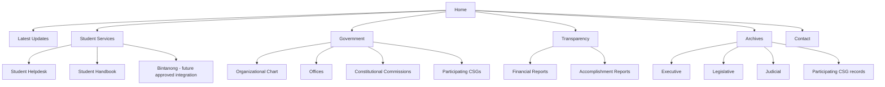
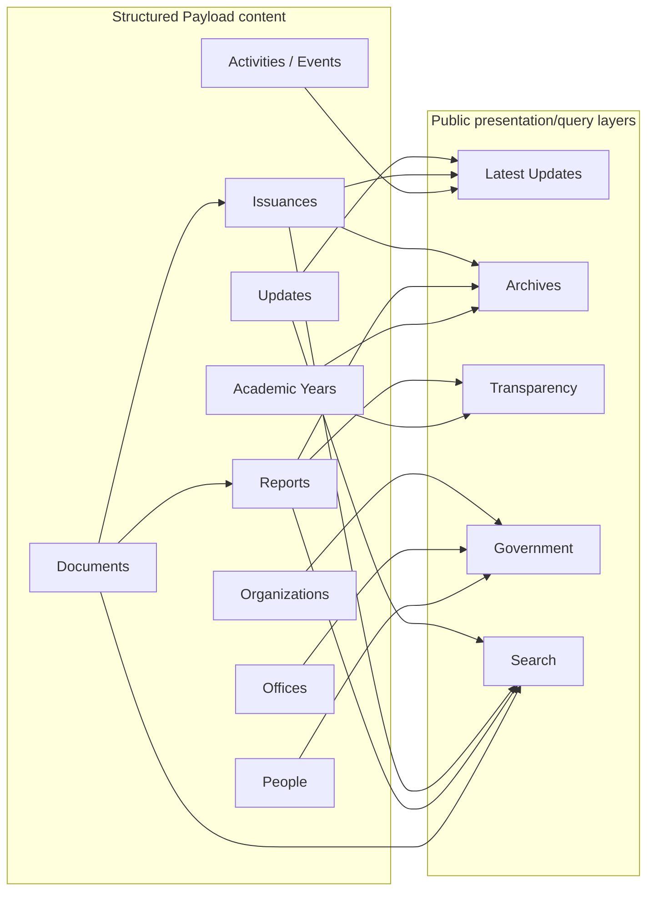
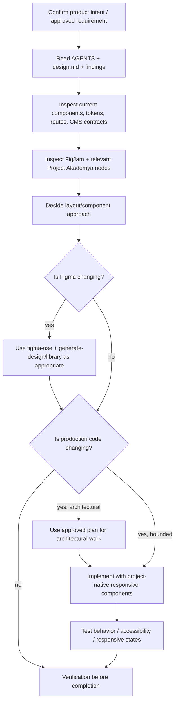

# Binturong design guide

Status: operational design guidance for Binturong. This document translates the approved
product/design findings into page structure, reusable interface patterns, responsive behavior,
and agent workflow. Read [design-architecture-findings.md](design-architecture-findings.md) for
the rationale and decision history behind these rules.

## Purpose

Binturong is a public-information, transparency, student-service, and institutional-records
portal for the Palawan State University University Student Government (USG).

Design shorthand:

> modern university publication × government service portal × institutional archive

The design must optimize for clarity, provenance, accessibility, navigation, and long-term
institutional continuity before visual novelty.

Binturong should feel like the adult institutional evolution of Project Akademya: recognizably
PalSU, but calmer, more structured, and substantially more document-oriented.

## Design source hierarchy

When sources disagree, resolve them in this order unless an explicit newer product decision says
otherwise:

1. Current user-approved Binturong requirements and product decisions.
2. This document for operational layout, responsive behavior, and component guidance.
3. [design-architecture-findings.md](design-architecture-findings.md) for rationale and historical
   design decisions.
4. The Binturong FigJam requirements board:
   https://www.figma.com/board/grbw5PtS8NvkmBdZvXJQxy/PalSU-USG-Website?node-id=32-78&t=5dptj1kj0CtLkw68-0
5. Project Akademya design remnants for PalSU-specific visual DNA:
   https://www.figma.com/design/HN3YftezbKwb2jdijABe02/Project-Akademya?node-id=1057-423
6. External reference systems according to their documented roles:
   - GovTech Malaysia `kd-portal` + MYDS: closest implementation/design neighbor and civic UI donor.
   - GOV.UK Design System: content hierarchy, restraint, forms, and accessibility.
   - USWDS: public-record lists, side navigation, filters, alerts, and document-heavy information.
   - BetterGov.PH: modern Philippine civic-tech presentation.
   - Provincial Government of Palawan: local public-sector information architecture.
   - arXiv: metadata-first formal-document presentation.

External references are donors, not visual skins. Do not import another institution's branding.

## Site information architecture



`Archives` and `Transparency` are public views over structured records. They are not dumping-ground
CMS collections.

## Record and presentation model



The 30-day freshness rule changes where a record is surfaced, not what the record is. A published
issuance remains an `Issuance`; after the freshness window it is primarily discovered through
Archives/search while retaining its canonical URL and metadata.

## Global page shell

### Desktop

```text
┌──────────────────────────────────────────────────────────────────────────────┐
│ [PalSU seal] PALAWAN STATE UNIVERSITY                         Search  Menu?  │
│              UNIVERSITY STUDENT GOVERNMENT                                  │
├──────────────────────────────────────────────────────────────────────────────┤
│ Home  Updates  Student Services  Government  Transparency  Archives Contact │
└──────────────────────────────────────────────────────────────────────────────┘
│                                                                              │
│                         PAGE-SPECIFIC CONTENT                                │
│                                                                              │
├──────────────────────────────────────────────────────────────────────────────┤
│ Institutional footer: USG • OSAS • contacts • accessibility • records       │
└──────────────────────────────────────────────────────────────────────────────┘
```

Use two levels of identity intentionally:

- authority band: PalSU + University Student Government identity;
- navigation band: task-oriented public navigation.

Do not force every secondary item into the top row. Government, Transparency, and Student Services
may expose accessible dropdown/mega-menu behavior on larger screens and collapse into grouped
mobile navigation.

### Mobile

```text
┌──────────────────────────────────┐
│ [seal] PalSU                     │
│ University Student Government    │
│                         Search ☰ │
├──────────────────────────────────┤
│ page title / breadcrumbs         │
├──────────────────────────────────┤
│                                  │
│ page content                     │
│                                  │
├──────────────────────────────────┤
│ institutional footer             │
└──────────────────────────────────┘
```

On mobile, preserve the information hierarchy rather than shrinking desktop navigation. Side
navigation becomes an in-flow section index, accordion, or explicit "On this section" control.

## Home layout

The homepage should behave like the front page of an institutional publication, not a SaaS landing
page.

```text
┌──────────────────────────────────────────────────────────────────────────────┐
│ GLOBAL AUTHORITY + NAVIGATION                                                │
├──────────────────────────────────────────────────────────────────────────────┤
│ HERO                                                                         │
│ [PalSU / USG officers documentary photograph]                               │
│ UNIVERSITY STUDENT GOVERNMENT                                                │
│ Official information, student services and institutional records.           │
├──────────────────────────────────────────────────────────────────────────────┤
│ OFFICIAL NOTICE / ADVISORY (only when there is something worth surfacing)   │
│ Important: ...                                                    View →     │
├──────────────────────────────────────────────────────────────────────────────┤
│ LATEST UPDATES                                                               │
│ 19 OCT  ANNOUNCEMENT  Student Consultation Schedule               Read →     │
│ 18 OCT  EXECUTIVE ORDER  EO No. 04, s. 2026        Record →   PDF ↓          │
│ 12 OCT  MEMORANDUM       Memo No. 17, s. 2026      Record →   PDF ↓          │
├──────────────────────────────────────────────────────────────────────────────┤
│ STUDENT SERVICES                                                             │
│ Helpdesk →              Student Handbook →             Bintanong → (future)  │
├──────────────────────────────────────────────────────────────────────────────┤
│ GENERAL PLAN OF ACTIVITIES                                                   │
│ 24 Oct  Student Consultation                                                 │
│ 28 Oct  General Assembly                                                     │
│ 03 Nov  ...                                                      All →       │
├──────────────────────────────────────────────────────────────────────────────┤
│ TRANSPARENCY                                                                 │
│ Financial Reports →                    Accomplishment Reports →              │
├──────────────────────────────────────────────────────────────────────────────┤
│ LATEST ISSUANCES                                                             │
│ EO No. 04       Establishing ...                              18 Oct          │
│ Memo No. 17     Guidelines ...                                12 Oct          │
│ Act No. 03      An Act ...                                     8 Oct          │
│                                                    Browse all records →       │
├──────────────────────────────────────────────────────────────────────────────┤
│ FOOTER                                                                       │
└──────────────────────────────────────────────────────────────────────────────┘
```

The hero establishes PalSU identity. It must not consume the majority of the page or push official
information below several screens of decorative content.

## Latest Updates layout

Use editorial list rows rather than a wall of cards.

```text
LATEST UPDATES
Official announcements, advisories and recently published records.

[ Search updates __________________ ]  [ Type ▾ ] [ Date ▾ ]

19 OCT 2026
ANNOUNCEMENT
Student Consultation Schedule
Short, plain-language summary of the update.
Office / authoring unit
Read update →
────────────────────────────────────────────────────────────────────

18 OCT 2026
EXECUTIVE ORDER
EO No. 04, s. 2026
Establishing the ...
Office of the President
View record →     PDF ↓
────────────────────────────────────────────────────────────────────
```

Announcements/news can have editorial imagery where useful. Formal records should favor document
metadata over thumbnails.

## Archive layout

Project Akademya's old directory sidebar is the ancestor of this pattern, but the new version is
flat, accessible, responsive, and content-first.

```text
ARCHIVES
Browse official USG records by branch, record type and academic year.

┌─────────────────────────────┬────────────────────────────────────────────────┐
│ ARCHIVE SECTIONS            │ Executive                                     │
│                             │                                                │
│ Executive                   │ [Search records __________________________]     │
│ Legislative                 │ Academic year [2026–2027 ▾]  Type [All ▾]     │
│ Judicial                    │                                                │
│ Participating CSGs          │ EXECUTIVE ORDER                               │
│                             │ EO No. 04, s. 2026                            │
│                             │ Establishing ...                 18 Oct 2026    │
│                             │ View record →  PDF ↓                          │
│                             │ ─────────────────────────────────────────────  │
│                             │ MEMORANDUM                                    │
│                             │ Memo No. 17, s. 2026             12 Oct 2026   │
└─────────────────────────────┴────────────────────────────────────────────────┘
```

Do not physically move old records into a separate collection. Archive pages query the same
records with age/type/branch/year filters.

## Issuance detail layout

Formal issuances are records first, articles second.

```text
Breadcrumbs: Archives / Executive / Executive Orders

EXECUTIVE ORDER
EO No. 04, s. 2026
Establishing the Committee on ...

Status: Published
Published: 18 October 2026
Effective: 18 October 2026
Issuing office: Office of the President
Academic year: 2026–2027

[ View official PDF ]  [ Download PDF ]

SUMMARY
Concise plain-language description where appropriate.

DOCUMENT INFORMATION
Document ID      USG-EO-2026-004
Version          1.0
File             PDF · 1.8 MB

RELATED RECORDS
Memo No. 17, s. 2026 →
General Plan of Activities AY 2026–2027 →

[record provenance / update history when applicable]
```

Do not hide the document number, issuing office, publication date, or canonical file inside body
copy.

## Accomplishment report layout — arXiv-inspired

Reports are document-first and metadata-dense. The website provides discovery and context around
the authoritative artifact.

```text
Breadcrumbs: Transparency / Accomplishment Reports

ACCOMPLISHMENT REPORT
University Student Government
Academic Year 2026–2027

Published: 19 October 2026
Version: 1.0
Responsible offices: Office of the President; Secretariat
Document ID: USG-AR-2026-001

[ View PDF ]  [ Download PDF ]

ABSTRACT / EXECUTIVE SUMMARY
A concise structured summary of major activities, outcomes, services and institutional work.

DOCUMENTS
PDF   Official Accomplishment Report          4.8 MB · 94 pages

RELATED RECORDS
General Plan of Activities AY 2026–2027 →
Financial Report — First Semester →
Executive Order No. 02, s. 2026 →

VERSION / PROVENANCE
v1.0 · Published 19 October 2026
```

Financial reports can use the same shell with less narrative content and stronger emphasis on the
canonical document, reporting period, responsible office, and publication metadata.

## Government layout

```text
GOVERNMENT
Structure and offices of the University Student Government.

┌─────────────────────────────┬────────────────────────────────────────────────┐
│ GOVERNMENT                  │ Organizational Chart                           │
│                             │                                                │
│ Organizational Chart        │ President                                      │
│ Executive Offices           │   ├─ Executive offices                        │
│ Legislative                 │   ├─ Secretariat                              │
│ Judicial                    │   └─ ...                                       │
│ Constitutional Commissions │                                                │
│ Participating CSGs          │ [structured org chart / office directory]      │
│                             │                                                │
│                             │ Current office holders                         │
│                             │ Name • position • term                         │
└─────────────────────────────┴────────────────────────────────────────────────┘
```

Model offices separately from people so historical office-holder changes do not require rewriting
the institutional structure.

## Transparency layout

```text
TRANSPARENCY
Financial and accomplishment records published by the USG and participating organizations.

┌─────────────────────────────┬────────────────────────────────────────────────┐
│ TRANSPARENCY                │ Financial Reports                              │
│                             │                                                │
│ Financial Reports           │ Academic year [2026–2027 ▾]                   │
│ Accomplishment Reports      │ Reporting period [All ▾]                       │
│                             │                                                │
│                             │ First Semester Financial Report                │
│                             │ Published 15 Oct 2026                          │
│                             │ View record →   PDF ↓                         │
└─────────────────────────────┴────────────────────────────────────────────────┘
```

## Student Services layout

Keep this section task-oriented and deliberately small in v1.

```text
STUDENT SERVICES

Student Helpdesk
Submit a concern or request through the approved service workflow.
[ Open Helpdesk ]

Student Handbook
Read or download the current handbook and related student guidance.
[ View Handbook ]

Bintanong
Future approved academic-guidance integration.
[ unavailable until integration is explicitly enabled ]
```

Google Forms is acceptable for Helpdesk v1. Do not invent a ticketing platform until the workflow
requires one.

## Contact layout

Treat Contact as an institutional directory, not a marketing lead form.

```text
CONTACT

Office of Student Affairs and Services
Student Welfare Services
Student Development Services
[official email / phone / office location where approved]

University Student Government
Official email
Official social channels
Official contact numbers
Office location / service hours where approved
```

Contact data should be CMS-managed and clearly distinguish official institutional channels from
individual officer contact details.

## Responsive behavior

1. Preserve semantic reading order between desktop and mobile.
2. Collapse side navigation into an in-flow section index or disclosure; never hide access to
   entire government/archive categories behind hover-only behavior.
3. Tables must either reflow into labeled rows/cards or support an accessible horizontal overflow
   strategy with retained headers.
4. Record metadata should stack before document actions on narrow screens.
5. Hero photography may crop responsively, but critical text must never be baked into the image.
6. Search and primary record actions must remain reachable without traversing the entire mobile
   navigation.
7. Touch targets should meet accessible sizing expectations; do not reproduce Project Akademya's
   desktop-only spatial assumptions.

## Visual system direction

### Identity

Preserve:

- PalSU seal and institutional authority;
- real campus/officer documentary photography;
- a strong PalSU-derived identity band;
- clear government/public-service hierarchy.

Retire:

- heavy glassmorphism;
- pervasive blur;
- giant translucent brown panels;
- image backgrounds behind dense records;
- oversized display text on information-heavy screens;
- cards for every content unit.

### Typography

Use a highly readable information typeface for the majority of the interface. Prefer an existing
project-approved family before adding one. Inter/Public Sans-like information typography is a
better baseline than using a display face everywhere.

Directional scale, subject to token validation:

| Role | Approximate desktop size |
| --- | ---: |
| Home statement | 44–56 px |
| Page title | 36–44 px |
| Section heading | 28–32 px |
| Record title | 18–24 px |
| Body | 16–18 px |
| Metadata | 14 px |
| Classification label | 12–14 px |

Do not treat these values as hardcoded component values if the implementation already has a token
system. Establish tokens first.

### Color

Do not sample production tokens from screenshots. Use approved PalSU/USG branding sources when
available. Build semantic roles such as:

- `background/default`
- `background/subtle`
- `surface/default`
- `text/primary`
- `text/secondary`
- `border/default`
- `brand/primary`
- `brand/secondary`
- `status/info`
- `status/warning`
- `status/error`
- `status/success`

The interface must remain usable if brand color is removed; hierarchy cannot depend on color alone.

### Spacing and surfaces

Prefer a restrained spacing scale, thin dividers, flat content surfaces, and low-radius containers.
Reserve stronger elevation for overlays/dialogs rather than normal document lists.

## Core reusable components

Create/reuse components based on repeated semantic roles, not visual convenience:

- `InstitutionalHeader`
- `PrimaryNavigation`
- `MobileNavigation`
- `Breadcrumbs`
- `SearchField` / `SearchBar`
- `OfficialNotice`
- `SectionHeading`
- `RecordList`
- `RecordRow`
- `RecordTypeBadge`
- `MetadataList`
- `DocumentAction`
- `DocumentFileRow`
- `FilterBar`
- `SideNavigation`
- `SectionIndex`
- `ServiceLink`
- `ActivityRow`
- `OfficeDirectoryEntry`
- `Person/OfficeHolderEntry`
- `Pagination`
- `EmptyState`
- `InstitutionalFooter`

Do not create a separate card component for every CMS collection if the same record/list pattern can
express them through composition.

## Mapping page patterns to Payload data

| Public pattern | Primary data source | Notes |
| --- | --- | --- |
| Home latest updates | `Updates`, recent `Issuances`, `Activities` | query by publish date/state |
| Latest Updates | `Updates` + recent official records | editorial + record rows |
| Archives | `Issuances`, `Reports`, `Documents` | query/filter layer, not collection |
| Issuance detail | `Issuances` + `Documents` | metadata-first record page |
| Transparency | `Reports` + `Documents` | grouped by type/year/organization |
| Report detail | `Reports` + `Documents` | arXiv-style document page |
| Government | `Organizations`, `Offices`, `People` | office structure separated from holders |
| Student Services | `Pages`, forms/external links | keep v1 small |
| Contact | `Organizations` / `Offices` / settings | official channels only |

## Accessibility and public-sector UX rules

1. WCAG-oriented semantics and keyboard behavior are required, not post-launch polish.
2. All navigation, dropdowns, disclosures, filters, and dialogs must work without pointer hover.
3. Visible focus indicators must be preserved.
4. Heading levels must represent document structure, not visual size.
5. Form inputs require explicit labels, errors, instructions, and server-side validation where
   applicable.
6. Links should describe destinations/actions; avoid repeated ambiguous "click here" labels.
7. PDF/document links should expose useful context such as file type and, where available, size.
8. Images require meaningful alternative text when informative; decorative images must be marked
   appropriately.
9. Color is never the sole status indicator.
10. Respect reduced-motion preferences; Binturong does not require ornamental animation to work.
11. Preserve readable line lengths for article/report summaries and metadata.
12. Public records must remain navigable with JavaScript-enhanced behavior failing gracefully where
   practical.

## Figma workflow

### Inspect before changing

When Figma tooling is available:

1. Inspect the Binturong FigJam requirement node directly.
2. Inspect the relevant Project Akademya frames directly rather than coding from screenshots.
3. Inventory existing components, variables, styles, and Code Connect mappings before creating
   replacements.
4. Check the repository's existing UI primitives before importing MYDS or another library.
5. Translate approved patterns into Binturong's own design tokens and components.

Generated Figma React/Tailwind output is a high-fidelity prototype/reference. Do not paste raw
absolute-positioned generated code into the production Next.js application. Rebuild it using the
project's semantic layout, responsive patterns, existing components, and CMS data boundaries.

### Design-system adoption

MYDS is a donor/reference, not a mandatory dependency. Before installing or importing any MYDS
package:

- inventory the existing `src/components/ui/` primitives and Tailwind setup;
- identify an actual gap;
- confirm license/version/framework compatibility;
- decide whether to reuse behavior, port a pattern, or install a dependency;
- test accessibility and visual integration with Binturong tokens.

Avoid maintaining two overlapping component systems without a specific reason.

## Agent design skills and routing

This section is guidance for agent harnesses that expose design/engineering skills. Skill names
may differ between harnesses; use the equivalent capability where necessary. Do not pretend a skill
is installed when it is not.

### Repository-local skills

The repository currently includes these local engineering skills:

| Task | Repository skill |
| --- | --- |
| Payload collections, hooks, access, API/admin | `binturong-open-usg/.agents/skills/payload/SKILL.md` |
| PostgreSQL/schema/index/RLS/performance | `.agents/skills/supabase-postgres-best-practices/SKILL.md` |
| Supabase services/storage/clients/MCP | `.agents/skills/supabase/SKILL.md` |

The root `.agents/skills/` directory currently contains Supabase/Postgres skills; the Payload skill
lives under the application workspace. Design/Figma skills may be supplied by the active agent
harness rather than stored in this repository.

### Harness design/process skills

| Situation | Skill/capability to use |
| --- | --- |
| Changing product behavior, IA, or visual direction | `brainstorming` before implementation |
| Approved architectural design requiring a staged build | `writing-plans` after spec approval |
| Any Figma Plugin API mutation/read requiring JS | `figma-use` first |
| Building/updating a full Figma page, screen, panel, or composed view | `figma-generate-design` together with `figma-use` |
| Creating/reconciling Figma tokens, components, variants, variables, or a library | `figma-generate-library` together with `figma-use` |
| Implementing an approved Figma screen in code | `figma-design-to-code` before implementation |
| Product implementation or bug fix | `test-driven-development` where applicable |
| Unexpected build/test/runtime behavior | `systematic-debugging` |
| Before claiming completion | `verification-before-completion` |
| Major feature slice before merge | `requesting-code-review` |

Do not invoke every skill merely because it exists. Route by the current stage and task.

### Recommended design-to-code sequence



### Figma-specific non-negotiables

When the active harness provides the named Figma skills:

- load `figma-use` before every `use_figma` call;
- use `figma-generate-design` for composed screen/view creation;
- use `figma-generate-library` when creating reusable components/tokens/variants;
- use `figma-design-to-code` before implementing Figma designs into the app;
- inspect existing screens/components before creating new equivalents;
- prefer design-system tokens and component instances over hardcoded primitives;
- preserve editable semantic layers in Figma rather than flattening a UI screenshot;
- validate the resulting screen visually and structurally before calling it complete.

## Design acceptance checks

A Binturong page/screen is not ready merely because it resembles the reference at one desktop
width. Before completion, verify the relevant subset of:

- requirements and content hierarchy match the approved Binturong source;
- desktop and mobile reading order are coherent;
- keyboard navigation and focus states work;
- navigation works without hover-only dependencies;
- metadata, document number, dates, office, and canonical file are visible where required;
- lists remain scannable without card overload;
- official records retain stable links and record identity;
- imagery does not obstruct information;
- color contrast and non-color status cues are acceptable;
- loading, empty, error, and no-results states exist where data can be absent;
- filters/search preserve understandable state and labels;
- unpublished/private content is not exposed through the public presentation;
- generated/prototype code has been converted into project-native layout/components;
- no temporary Figma assets, placeholder copy, or reference-only branding remains.

## Deliberate non-goals

Unless explicitly approved later, do not:

- recreate Project Akademya pixel-for-pixel;
- clone `kd-portal` or Malaysia.gov.my branding;
- make Binturong look like a SaaS admin dashboard;
- build the homepage around decorative feature cards;
- render every PDF as a generic blog post;
- make official records depend on MCP/AI for basic navigation;
- add a bespoke helpdesk ticketing system for v1;
- expose internal agent/model/version details as part of the public design;
- treat the current Payload starter UI as the final product visual system.

## First design implementation slice

After the domain schema is approved, the first coherent design slice should be:

1. Binturong design tokens and base typography.
2. Institutional header + responsive primary navigation.
3. `OfficialNotice`.
4. `RecordRow` + metadata/document-action primitives.
5. Home shell using real CMS queries or representative typed fixtures.
6. Issuance detail page.
7. One archive/filter view.
8. Mobile/navigation/accessibility verification.

That slice proves the visual system against both editorial and formal-record content before the
team expands to Transparency, Government, and the full archive surface.
